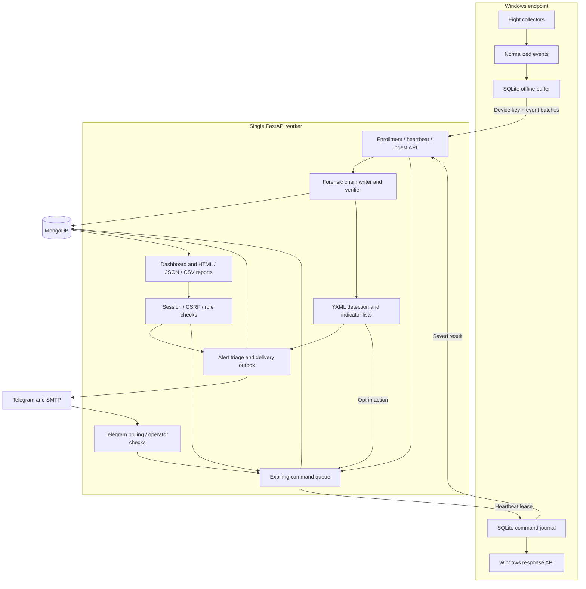

# Architecture

ShadowTrace separates endpoint collection from server-side detection and operator decisions.
The current deployment is one FastAPI/Uvicorn process and MongoDB, with the dashboard served
by that same process. Windows endpoints authenticate with distinct device keys.

## Collection and enrollment

An administrator creates an expiring enrollment token with a usage limit. Enrollment
returns a random device key; the server stores its hash. Subsequent requests resolve the
device from that key, so an endpoint cannot choose another device's event/command identity.

The four common collectors observe processes, watched files, connections and browser
history/downloads. Windows collectors observe Security Event Log, USB, Wi-Fi and Defender.
The agent normalizes records, assigns event IDs/sequences and saves them in SQLite before
upload. Saved cursors support restart recovery. First-run baselines avoid replaying an
entire historic browser/Event Log database. Polling and finite upstream log retention still
limit what can be observed.

## Ingestion and forensics

Within a device lock, ingestion validates sequence and event identity, writes events in chain
order and saves the device anchor. SHA-256 links each canonical record to the prior hash.
Retries recognize already stored events; recovery checks interrupted writes against saved
state. A broken/deleted tail is not silently accepted as a new baseline.

Verification recomputes a device's chain against its recorded length/head. Reports include
the result, anchor and linked evidence; missing evidence is explicit. A report holds the
device lock while reading its evidence/verification snapshot. Events have no retention TTL,
because deleting arbitrary records would destroy chain verification.

The database administrator is trusted. Hash chaining detects changes relative to the saved
anchor, but an attacker who changes both collections can replace the history. This is not an
externally notarized or digitally signed evidence ledger.

## Detection and notifications

Validated YAML rules and local lists load at startup. Single-event matching and per-device
thresholds use the durable event store, so offline/out-of-order arrivals can still contribute.
The detection cursor, individual rule firings, deduplicated alerts and notification jobs are
persisted separately. Recovery workers pick up pending work after a restart.

Outbox delivery is independent of ingestion. Each channel has retry/backoff and a per-device
rate budget; digests combine pending incidents. Telegram and SMTP are opt-in. A lost external
acknowledgement can produce duplicate messages even though the internal jobs are durable.
Live delivery therefore has at-least-once behavior rather than a guarantee of one message.

## Operator access

Dashboard accounts have admin, analyst or viewer roles. Argon2id protects passwords; random
session tokens are stored as hashes. Cookies are HttpOnly and SameSite Strict, with Secure
enabled for HTTPS deployment. The database enforces expiry and session version revocation.
The login limiter records IP/account attempts; password failures use a generic response.

The UI keeps the CSRF token in memory and sends it with mutations. Server checks enforce
same-origin requests, authentication and role policy independently of visible UI controls.
Static shell assets contain no endpoint data. Content Security Policy restricts scripts,
styles and network access to the same origin. HTML reports autoescape stored content;
CSV fields guard against spreadsheet formula interpretation.

Telegram authorization uses both the configured chat and explicit numeric operator IDs.
Buttons hold short opaque callback references; evidence targets live on the server.
Response confirmation belongs to the initiating operator, expires after 60 seconds, and
produces an idempotent command. Poll offsets and callback results survive server restart.

## Command delivery and execution

Commands record actor, reason, target evidence, expiry and transitions. Heartbeats lease
delivery, allowing retry when an acknowledgement is lost. Only the target device key can
retrieve and acknowledge a command. The server returns responses as endpoint claims.

The endpoint must opt in and allow the action. It stores the command in a separate SQLite
journal before execution, then stores the result before reporting it. Retransmission returns
the saved result. An action interrupted before the result is persisted becomes `unknown` on
restart and is not automatically executed again.

Kill operations compare PID, image and creation time on the Windows process handle that
will be terminated. The agent, ancestors and critical/protected processes are refused.
Lock success means the asynchronous Windows request was accepted. The journal and command
history cannot independently prove that a compromised endpoint performed remediation.

## Deployment boundaries

Use one server worker; the locks coordinating writes and actions are process-local.
MongoDB, the server filesystem and the local administrative CLI require trusted access.
The supplied Windows installer restricts its code/config/data to SYSTEM/Administrators;
the underlying Python installation must remain present. It runs in one administrator's
interactive logon session, not a multi-user service.

Use TLS and secure cookies outside localhost, set the dashboard public URL, and configure
trusted proxy forwarding. Agent keys remain protected by ACLs rather than DPAPI. The
[plan](PLAN.md#12-full-product-roadmap-retained-as-future-work) lists scaling, signing,
packaging, platform expansion and retention work beyond this MVP.
